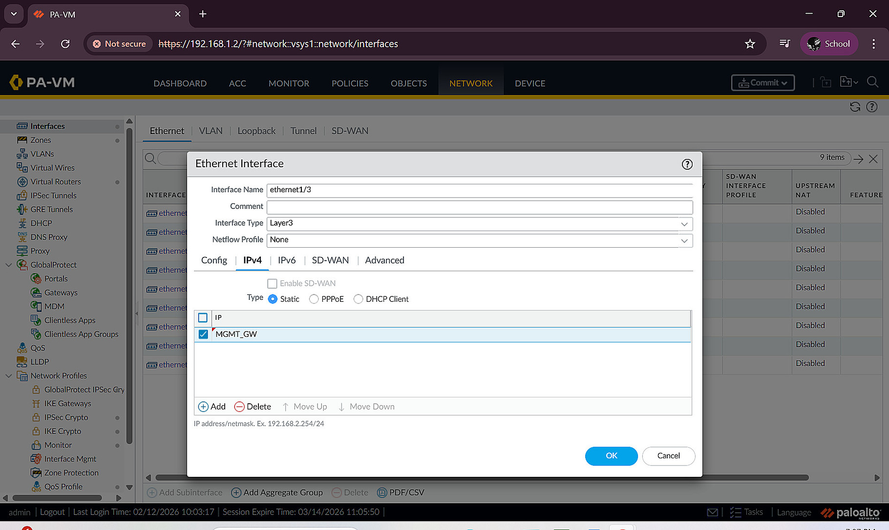
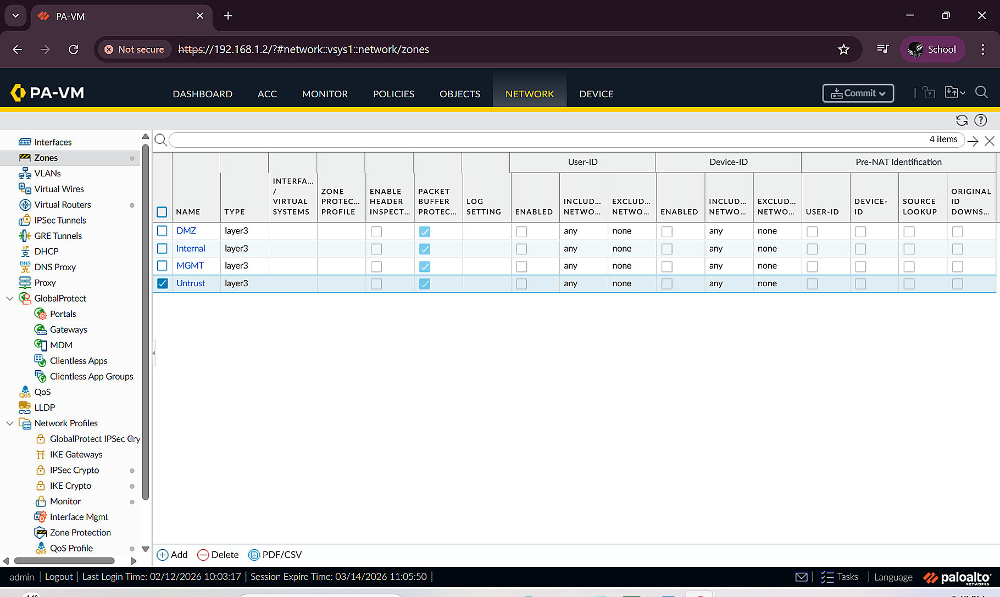
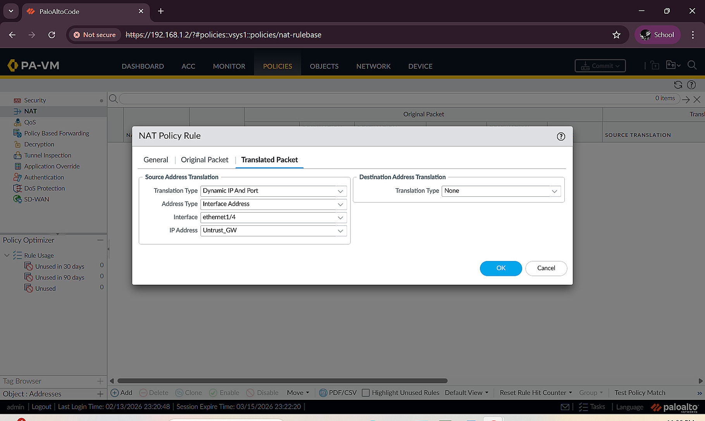
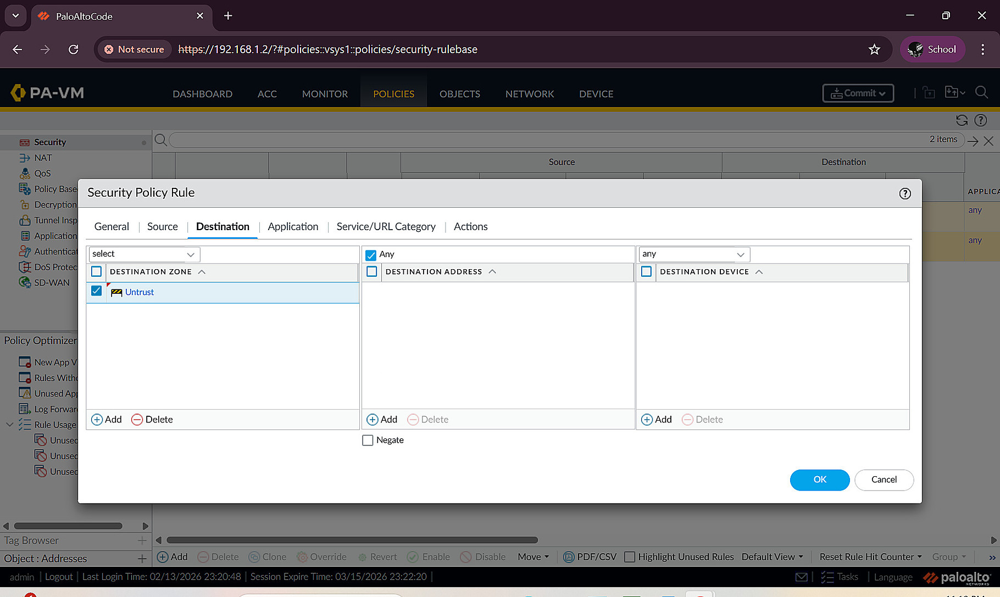
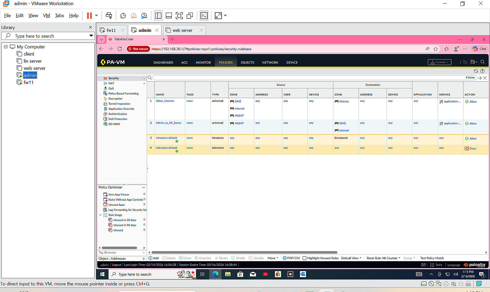
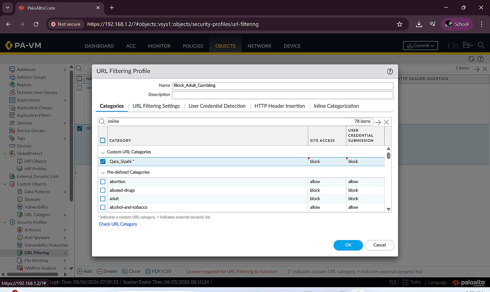
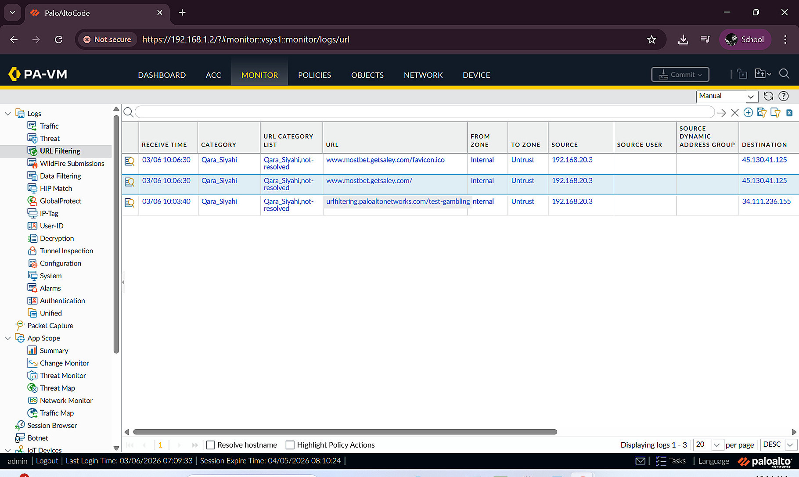
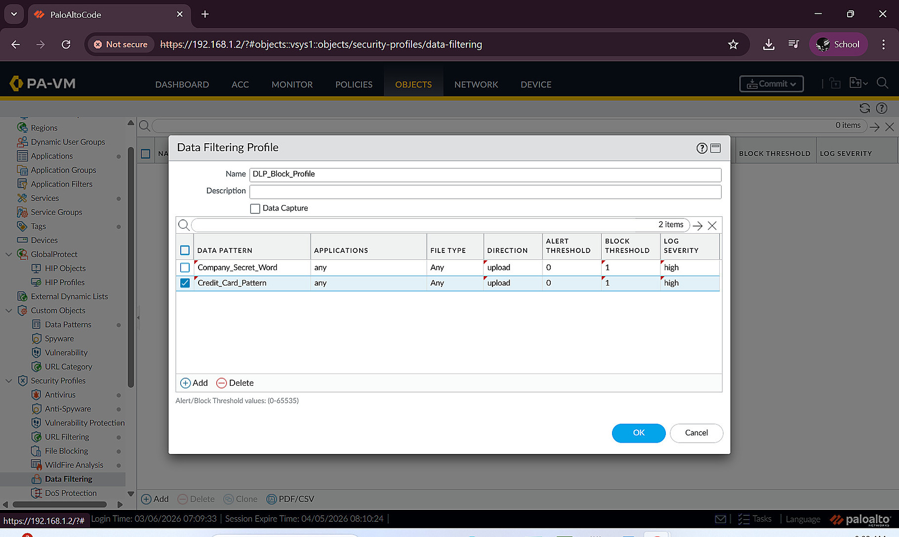
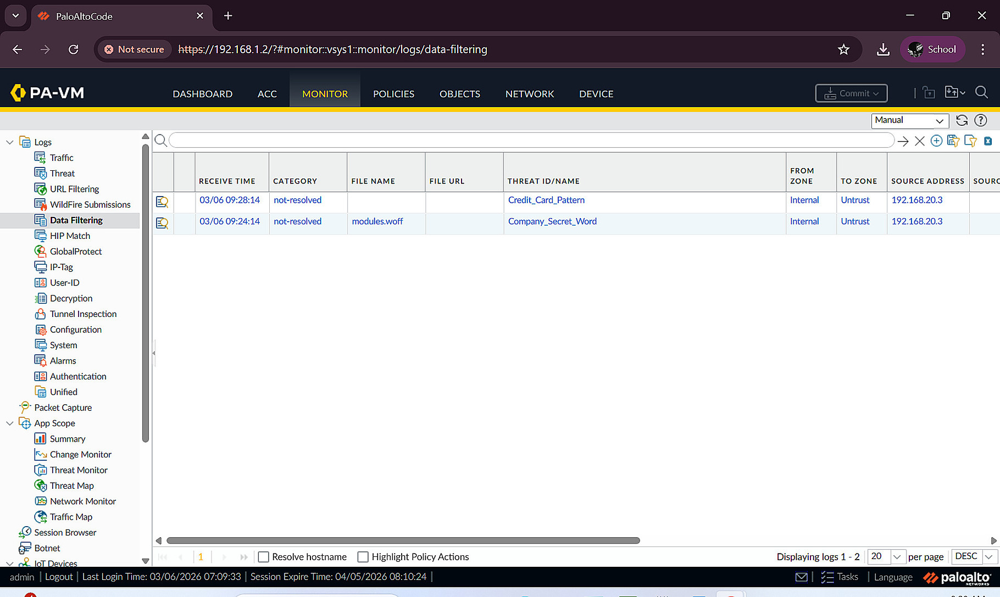

# Palo Alto NGFW: Network Segmentation, Access Control and Data Filtering

**Project:** Enterprise Security Infrastructure and SOC Monitoring  
**Area:** Blue Team / Network Defence  
**Environment:** VMware training lab with Windows and Red Hat Enterprise Linux endpoints

## Objective and environment

The first defensive task was to establish a centrally managed network perimeter and separate systems according to their purpose. A Palo Alto Networks next-generation firewall (NGFW) provided inter-zone routing, access control, outbound NAT and policy-based inspection. The environment consisted of four distinct zones:

| Zone | Lab subnet/interface | Purpose |
| --- | --- | --- |
| DMZ | `192.168.10.0/24` | Externally accessible web services |
| Internal | `192.168.20.0/24` | Internal Windows and Linux systems |
| Management | `192.168.30.0/24` | Administrative workstation and security monitoring systems |
| Untrust | External uplink (`10.10.10.2` in the lab) | Outbound connectivity |

The purpose of this design was not to make every zone universally reachable. Administrative access, internal services and Internet access were handled through separate rules. The addresses above belong to the isolated laboratory environment.

## 1. Initial firewall deployment and Layer 3 interfaces

1. Attached the required virtual interfaces in VMware, accessed the management console and established an initial management connection.
2. Set the firewall hostname and time zone, then changed the management address to a stable configuration.
3. Created the `DMZ_Zone`, `Internal_Zone`, `Mgmt_Zone` and `Untrust_Zone` security zones.
4. Assigned the corresponding Ethernet interfaces to Layer 3 mode, associated each interface with its security zone and provided the interface gateway address.
5. Associated the Layer 3 interfaces with the default virtual router, committed the changes and checked interface status.
6. Applied restricted interface management profiles to permit necessary diagnostic traffic without exposing administrative services unnecessarily.

*Figure 1. Palo Alto Layer 3 interface settings in the lab.*

*Figure 2. Interface status and zone assignment overview.*

## 2. Routing, Source NAT and Internet access

After the interface configuration, the firewall required explicit routing and policy controls:

1. Added the DMZ, Internal, Management and Untrust interfaces to the virtual router.
2. Configured a default route, `0.0.0.0/0`, through the Untrust side and its next-hop gateway.
3. Created an outbound Source NAT policy using Dynamic IP and Port (DIPP), translating permitted private clients to the external interface address.
4. Added the related allow rule under **Policies > Security**. The rule defined source zones, destination zone, allowed traffic and logging at session end.
5. Tested connectivity from an administrative Windows workstation using gateway pings and external DNS/IP connectivity checks.

Source NAT alone does not authorise traffic in this configuration. The corresponding security policy must also allow the session. I verified this distinction while troubleshooting the initial traffic flow.

*Figure 3. Outbound NAT rule configuration.*

*Figure 4. Security rule with explicit source and destination zones.*

## 3. Protecting firewall management access

A dedicated management zone was used to separate administrative access from ordinary traffic. I created an interface management profile allowing **HTTPS and SSH** for administration, together with limited ICMP for connectivity tests. This profile was bound to the management-facing Layer 3 interface rather than applied indiscriminately to every zone. Internal and DMZ interfaces retained more restricted diagnostic settings; the Untrust side was not intended to expose these services.

The configuration was committed and checked from the designated administrative workstation. This demonstrated how interface management profiles and zone-based security policies serve different purposes: one determines which services the firewall interface itself exposes; the other controls transit traffic between networks.

## 4. Inter-zone policy and segmentation tests

The lab requirements included management access to designated hosts and restrictions on less-trusted systems reaching sensitive internal resources. The `Admin_to_All_Zones` rule was created with the Management zone as the source and specified Internal/DMZ destinations. Session-end logging was enabled to support later investigation.

During testing, one Linux host sent packets through an unintended gateway because of a host networking/ARP issue. The network adapter settings were corrected, the stale ARP entry was cleared and connectivity was retested. Administrative reachability to the intended hosts was then checked without opening blanket access from the DMZ to the Internal network.

*Figure 5. Policy list used for segmented access and management traffic.*

## 5. URL filtering

The next task was to enforce restrictions on outbound web content. Under **Objects > Security Profiles > URL Filtering**, I created a profile for categories required by the training scenario. In addition to adult content and gambling, the documented policy included higher-risk categories such as malware, phishing, command-and-control, proxy avoidance and certain file-sharing services.

The profile was attached to the appropriate Internet access security rule, and the changes were committed. Testing from an internal Linux endpoint used both a browser and command-line requests. The firewall's blocked-page response and traffic records were used as evidence that the profile was being applied.

*Figure 6. Selected URL categories and their enforcement actions.*

*Figure 7. URL filtering activity in the firewall traffic logs.*

## 6. Data filtering / DLP proof of concept

To test an outbound data-loss-prevention control, I configured custom data patterns for a laboratory-only confidential keyword and a 16-digit numeric pattern representing test payment-card-like values. These patterns were included in a Data Filtering profile with an **Upload** direction, a block threshold and high-severity event logging.

The profile was attached to the outbound security rule. From an internal endpoint, test values were submitted to a public DLP testing page. The firewall response and related log entries were checked to confirm that the selected test traffic was blocked.

This was a **proof of concept**, not a production payment-data classifier. A simple 16-digit pattern can also match unrelated numbers and should not be treated as reliable card verification. It was sufficient for the stated training exercise.

*Figure 8. Data Filtering profile and laboratory matching rules.*

*Figure 9. Logged Data Filtering events after testing.*

## Results and lessons learned

The lab demonstrated functional separation of security zones, controlled administration, outbound NAT, URL filtering and data filtering. I validated the changes with connectivity tests, policy checks and firewall logs. The most important lessons were to distinguish routing/NAT from authorisation, commit and verify each policy change, minimise administrative exposure and use logs to validate what the firewall actually enforced.

**Scope:** This report describes an educational deployment and its observed lab tests. It does not claim that the setup is production-ready or that every attack technique can be prevented by these controls.
