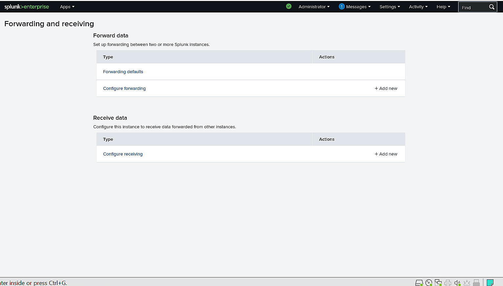
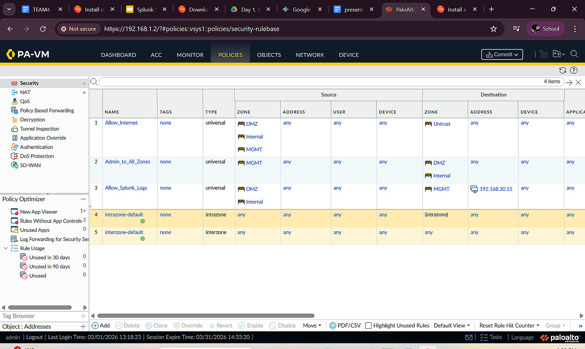
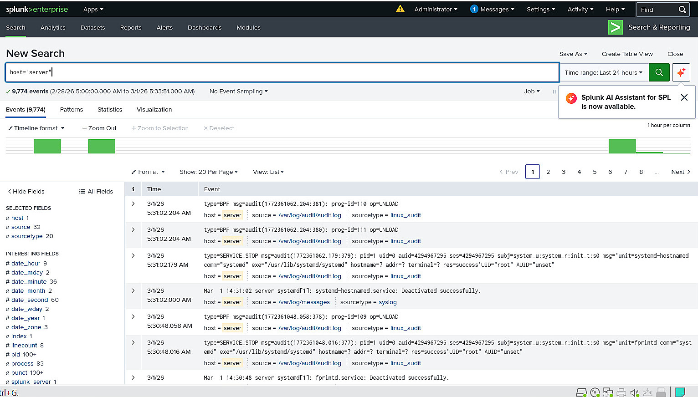
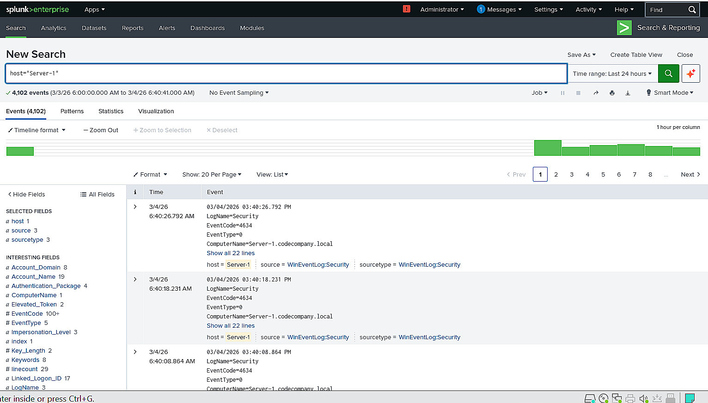
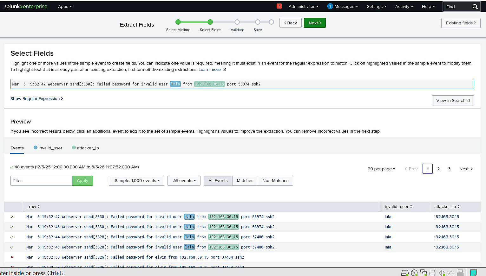
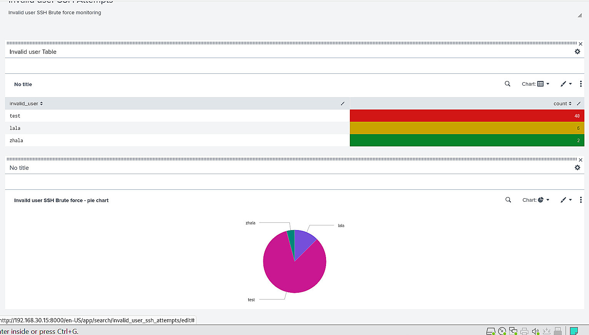

# Splunk Enterprise: Centralised Logging, SSH Investigation and SOC Dashboards

**Project:** Enterprise Security Infrastructure and SOC Monitoring  
**Area:** Blue Team / Security Monitoring and Alerting  
**Environment:** Splunk Enterprise on Red Hat Enterprise Linux, Windows and Linux log sources

## Objective

The SIEM task focused on collecting logs from multiple endpoints in one place, identifying authentication-related indicators and presenting findings through dashboards and alerts. Splunk Enterprise was placed in the Management zone. Linux and Windows endpoints in other zones used Splunk Universal Forwarders to send their data over approved network paths.

## 1. Deploying Splunk Enterprise on RHEL

1. Prepared a dedicated RHEL virtual machine and installed the Splunk Enterprise RPM package.
2. Launched the Splunk service and accessed its web management interface from the permitted network.
3. Configured startup behaviour so Splunk would be available after system reboot.
4. Configured the Linux host firewall for the necessary service access while avoiding unnecessary open ports.
5. Enabled a receiving endpoint in Splunk for Universal Forwarder traffic on **TCP 9997**.

The deployment separated the web interface used for analysis from the ingestion path used by endpoint agents.



*Figure 1. Splunk receiving/forwarding settings in the training environment.*

## 2. Restricting log-forwarding traffic through Palo Alto

Because the Splunk server was hosted in the Management zone, sending logs to it required an explicit firewall rule. A service object was created for the Splunk forwarding port (`9997/tcp`), followed by a rule that allowed the approved source zones to connect to the designated Splunk server. Session logging was enabled for observability.

The goal was to allow log ingestion without giving endpoint networks unrestricted access to the monitoring infrastructure. This was tested by checking endpoint connectivity and the appearance of received events in Splunk.



*Figure 2. NGFW policies limiting cross-zone access to the monitoring server.*

## 3. Forwarding logs from Linux hosts

Splunk Universal Forwarder was deployed on the Linux systems that supplied operational and security telemetry. For each endpoint, the process included installing the forwarder, identifying the central Splunk receiver, configuring the monitored sources and starting the forwarder service.

A representative command used during the exercise was:

```bash
./splunk add forward-server <SPLUNK_SERVER_IP>:9997
```

Host-specific addresses are deliberately omitted from reusable examples in the public report. I checked receiving status in the Splunk interface and confirmed that events from multiple lab systems could be searched centrally.



*Figure 3. Centralised events collected through the forwarder pipeline.*

## 4. Windows event collection

A Splunk Universal Forwarder was also installed on a Windows administrative endpoint. The setup involved selecting Windows log sources, entering the approved receiving destination and verifying connectivity. The resulting events were checked in Splunk alongside Linux records.

This was useful because the same investigation interface could be used across operating systems, without treating Windows and Linux logs as having identical field names or event structures.



*Figure 4. Windows-related events visible in Splunk search results.*

## 5. Investigating failed SSH authentication attempts

The main analysis example was suspicious SSH authentication activity. I searched the collected Linux logs for repeated failed login events, reviewed raw message formats and identified fields useful for investigation, including the source address and targeted account.

The workflow included:

1. Filtering events by the authentication-failure pattern and a relevant time range.
2. Inspecting raw events to understand the source data rather than assuming a predefined schema.
3. Using Splunk's regular-expression field extraction to separate the source IP address and attempted username.
4. Checking the extracted fields against raw messages for accuracy.
5. Aggregating results by source address, username and number of attempts to identify repeated activity.



*Figure 5. Creating structured fields from authentication logs.*

## 6. Building a SOC dashboard

Based on the extracted fields, I built a dashboard to make authentication activity easier to review. The report documents three visualization styles: a table with conditional formatting, a pie chart showing the distribution of targeted accounts and a single-value indicator representing a summary count.

The table helped identify noisy sources; the chart made account targeting patterns easier to compare; the single-value panel provided a quick overview. During the project, I checked that the dashboard components updated when the search results or time range changed.



*Figure 6. Dashboard panels showing failed SSH login patterns.*

## 7. Mobile access with Splunk Secure Gateway

The project also explored Splunk Secure Gateway and the Splunk Mobile application for viewing dashboards on an approved device. This included enabling the gateway, registering the mobile client and verifying that the SOC dashboard could be viewed remotely. No device registration codes, user identifiers or account screenshots are reproduced here.

## 8. Email notifications

For proactive alerting, I configured SMTP-based email notifications in Splunk and created an alert linked to suspicious authentication activity. The rule specified a search, trigger criteria and a notification action. I tested the end-to-end mechanism and reviewed the resulting message.

Credentials, app passwords, personal email addresses and provider-specific settings are intentionally excluded from this public portfolio. The reusable lesson is the event-to-search-to-alert workflow, not the private values used by the test account.

## 9. Telegram notifications

I also worked with the Telegram Alert Action integration. A bot-based notification workflow sent selected Splunk alert information to a designated test destination. Alert content could use search-result fields, such as source IP and affected username, to provide context.

For privacy and security, this public report does not include bot tokens, chat IDs, personal conversations or screenshots of the messaging application.

## Results and lessons learned

The result was a working lab workflow from endpoint log collection to central analysis, visualization and notification. It reinforced the practical importance of normalising fields, checking the reliability of extracted values and restricting cross-zone SIEM access to the required ports and hosts. Dashboards and alerts were based on the actual collected events, not on static mock data.

**Scope:** This is a portfolio account of the documented training exercise, not a claim of 24/7 production SOC operations.
