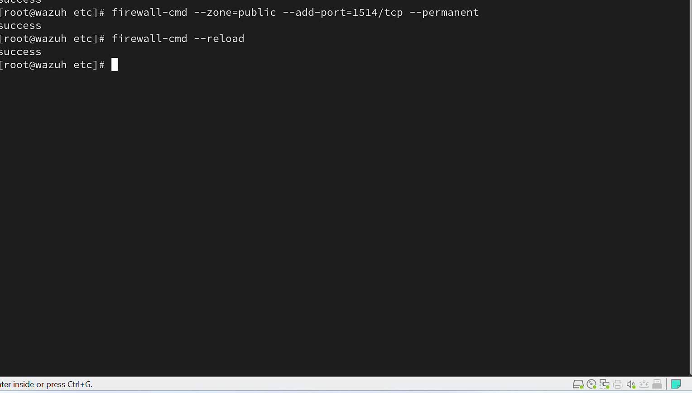
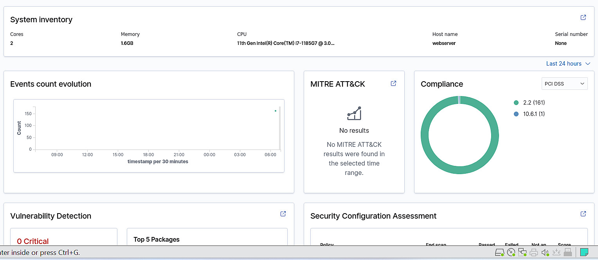
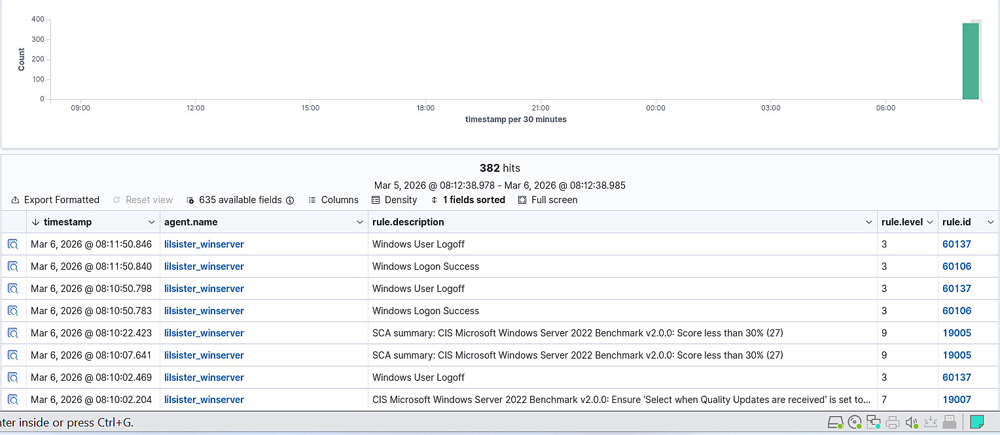
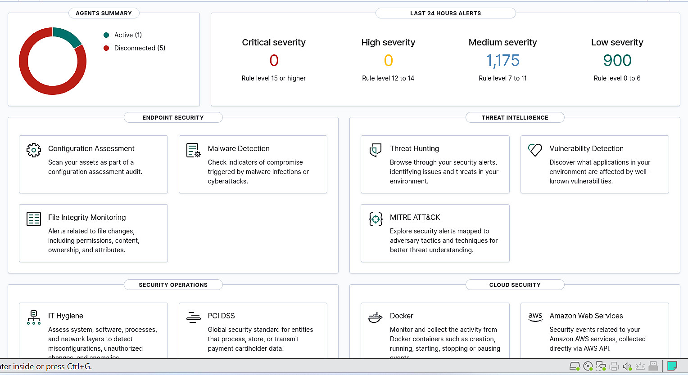
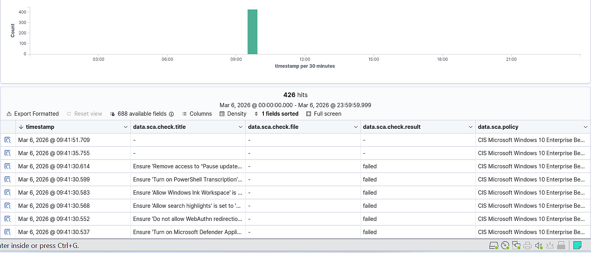
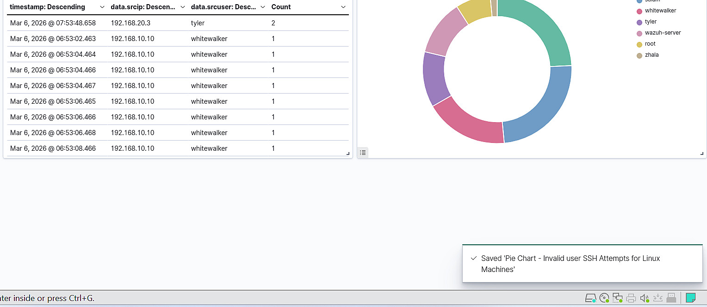
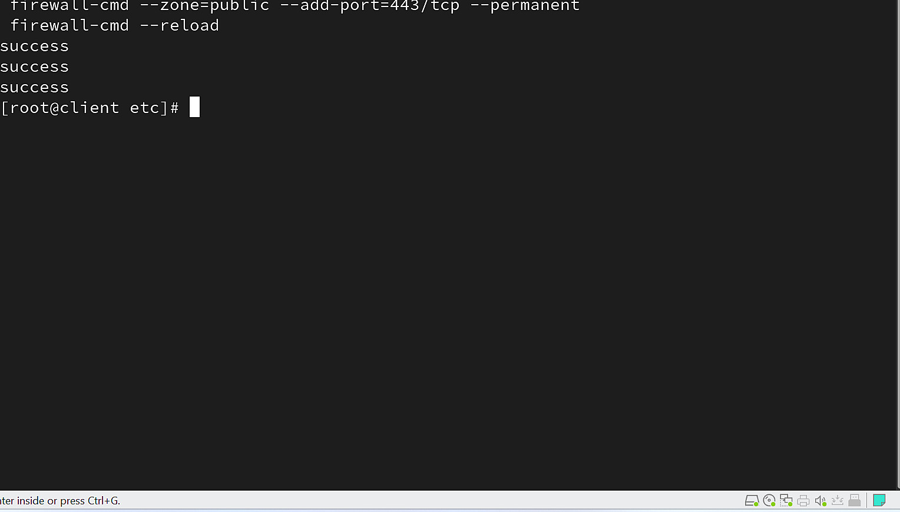

# Wazuh: Endpoint Monitoring, Threat Intelligence and Active Response

**Project:** Enterprise Security Infrastructure and SOC Monitoring  
**Area:** Blue Team / Endpoint Detection and Response  
**Environment:** Wazuh on Red Hat Enterprise Linux, Windows and Linux agents, Palo Alto NGFW

## Objective and architecture

The Wazuh part of the project focused on endpoint visibility, configuration assessment, suspicious login activity, monitored file changes and automated defensive actions. An all-in-one Wazuh deployment was installed in the Management zone with three core components:

- **Wazuh Indexer:** stores and indexes incoming security events.
- **Wazuh Manager:** receives agent data and applies decoders, rules and active-response logic.
- **Wazuh Dashboard:** provides the interface for agent administration, investigation and visualisation.

The objective was to make endpoint events observable centrally and connect selected detections to alerting or response actions. All activity was carried out in a controlled virtual lab.

## 1. Installing the central Wazuh platform

1. Prepared the RHEL virtual machine and installed the all-in-one Wazuh stack using the documented installation workflow.
2. Confirmed availability of the Manager, Indexer and Dashboard components.
3. Configured the host firewall to support agent connections and enrolment.
4. Used the Wazuh console to organise endpoints into groups for Linux and Windows systems.

Separate groups allowed operating-system-specific policies and configurations to be managed more systematically.

*Figure 1. Host firewall configuration for Wazuh agent communication.*

## 2. Restricting Wazuh traffic with Palo Alto NGFW

The Wazuh server was placed in the Management zone rather than exposed to every internal system without limits. A dedicated Palo Alto rule allowed endpoints to reach the specified Wazuh server on the required agent communication and enrolment ports:

| Purpose | Protocol and port |
| --- | --- |
| Agent communication | TCP 1514 |
| Agent enrolment | TCP 1515 |

The NGFW policy restricted the destination to the Wazuh host and limited the services to these defined ports. This was separate from access to the Wazuh administrative interface.

## 3. Deploying agents on Linux and Windows endpoints

For Linux systems, I generated an agent deployment command in the Wazuh console, selected the relevant package type and architecture, and set the Manager endpoint and assignment group. After installation, the service was enabled and started with systemd.

The project also included Windows machines, including servers and clients. I checked the registered agents from the central dashboard, compared their operating system information and confirmed the status of the monitored hosts. The agent view made it possible to distinguish connected hosts from inactive or unregistered ones.

*Figure 2. Registered endpoint and security-monitoring overview.*

*Figure 3. Endpoint events received by the Wazuh platform.*

## 4. Security Configuration Assessment (SCA)

I used the built-in Security Configuration Assessment feature to examine security control results on monitored endpoints. The SCA view provided an overview of successful and failed configuration checks and surfaced areas requiring attention.

The assessment was used as a practical hardening reference: identify a failed check, understand which configuration it refers to, consider the effect of a change and reassess. A compliance score is useful for prioritisation, but it is not proof that a system is free from vulnerabilities.

*Figure 4. Security Configuration Assessment results.*

*Figure 5. Detailed assessment events and checks.*

## 5. SSH monitoring and a custom dashboard

The project included a custom dashboard dedicated to SSH authentication failures. In Discover, I filtered security events related to failed logins, including relevant Wazuh SSH/sshd rule messages. The data was then used to build:

- A table of source IP addresses, targeted usernames and counts of failed attempts.
- A pie chart to display how authentication failures were distributed across targeted accounts.
- A dashboard combining the visualizations with a time filter.

This approach made repeated attempts easier to locate without manually reading each raw log entry. The dashboard supported investigation; it was not an automatic determination that every failed login was malicious.

*Figure 6. Custom dashboard for SSH failure analysis.*

## 6. File Integrity Monitoring (FIM) and VirusTotal integration

Wazuh File Integrity Monitoring was configured to watch selected directories and report file creation or modification. The monitoring workflow generated file hashes that could be used for threat intelligence lookups. The project then integrated VirusTotal through Wazuh Manager to evaluate the reputation of those hashes.

The sequence was:

1. Configure watched directories through the agent's `<syscheck>` settings.
2. Enable appropriate file metadata and hash collection.
3. Configure the VirusTotal integration in the Manager's `<integration>` section.
4. Generate a controlled test event and check the resulting alert fields in Wazuh.

The external reputation lookup used file **hashes**, not the contents of the entire file. The private VirusTotal API key and identifying account details have intentionally been omitted from this public version.

## 7. Active Response: file handling

The exercise explored automatic handling of a file flagged as malicious by the threat intelligence workflow. An Active Response rule was linked to a selected trigger so that a local endpoint command or script could be executed when that condition occurred.

The design included a response command, an event-based trigger and a chosen execution location. This is useful for understanding the path from detection to containment, but response scripts need to be tested carefully: a false positive could remove or isolate a legitimate file. This report documents the training configuration without publishing operational credentials, full script secrets or personal paths.

## 8. Active Response: temporary IP blocking

A second Active Response workflow used Wazuh's `firewall-drop` command to block traffic from an address associated with selected high-severity or repeated-authentication events. The response was configured with a time limit rather than as an indefinite block, reducing the risk of permanent lockout when conditions were misclassified.

In the reported exercise, the process included identifying a rule or severity trigger, connecting it to the firewall-drop command, selecting local agent execution and restarting the necessary agent service. Resulting events and firewall state were reviewed to check whether the desired response was applied.

*Figure 9. Endpoint firewall commands associated with the response exercise.*

## 9. Email notifications

SMTP email notifications were configured to deliver selected higher-severity events instead of sending every low-level log entry. The configuration considered the notification destination, a severity threshold and contextual fields such as event time, affected endpoint and relevant indicator. This helped illustrate the tradeoff between prompt notification and unnecessary alert volume.

No email address, SMTP credentials or real account information is reproduced in this portfolio.

## 10. Telegram notifications

The project also explored sending Wazuh notifications through Telegram using a custom integration and webhook/script workflow. Selected events were eligible for forwarding based on severity or response conditions. This was a learning exercise in integrating monitoring platforms with external notification systems.

Bot tokens, chat identifiers, private messages and integration secrets are intentionally excluded. The presence of this capability in a lab should not be confused with an audited production incident-notification service.

## Results and lessons learned

The Wazuh deployment connected Windows and Linux endpoint telemetry to centralised event analysis. It supported configuration assessment, SSH anomaly monitoring, FIM, VirusTotal reputation enrichment and rule-based responses. The project was particularly useful for understanding the difference between **detecting** an event, **enriching** it with external data, **notifying** an analyst and **acting** on it through Active Response. Each step requires its own validation, and automated actions must be designed with false-positive risk in mind.

**Scope:** Controlled academic lab. The report describes the implemented and documented configuration and tests; it does not claim zero-day detection, guaranteed malware prevention or production-grade reliability.
